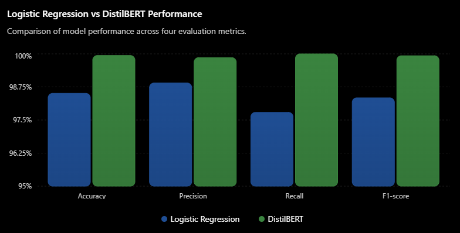
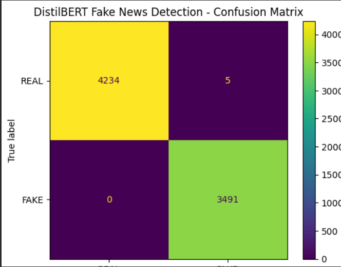
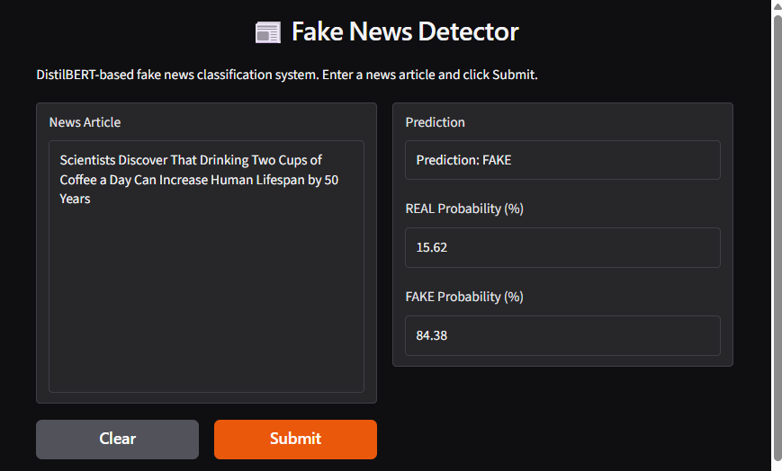

# 📰 Fake News Detection using DistilBERT

A Transformer-based NLP project that classifies news articles as **REAL** or **FAKE** using **DistilBERT**. The project also compares the Transformer model with a traditional **TF-IDF + Logistic Regression** baseline.

---

## 📌 Overview

Fake news detection is a text classification task in which a model learns patterns from labeled news articles and predicts whether a new article belongs to the REAL or FAKE class.

This project implements and compares two approaches:

- **TF-IDF + Logistic Regression** — a traditional machine learning baseline.
- **DistilBERT** — a Transformer-based deep learning model.

The trained DistilBERT model can also be used through an interactive **Gradio interface** to generate predictions.

> **Important:** This is a text classification system, not an independent fact-checking system. It does not verify claims against external sources.

---


## Phase 1: Robustness and Reliable Evaluation

Completed on October 23, 2026.

This phase investigates potential near-duplicate overlap in the original
random split and evaluates a freshly fine-tuned DistilBERT model using a
similarity-aware grouped split.

### Dataset and split

| Item | Result |
|---|---:|
| Articles after exact-text deduplication | 38,646 |
| Robust training articles | 30,919 |
| Robust validation articles | 7,727 |
| Similarity threshold used to construct groups | 0.95 |
| Maximum neighbors considered per article during grouping | 10 |

The grouping procedure used normalized text, TF-IDF features, nearest
neighbors, and connected components. The top-10-neighbor limit means this
is an approximate similarity-aware split, not a guarantee that every
similar article was detected.

A post-split audit found 31 validation articles with maximum training
similarity >= 0.90 and none >= 0.95 under the audit configuration.

### Model comparison on the same validation split

| Model | Accuracy | Weighted Precision | Weighted Recall | Weighted F1 |
|---|---:|---:|---:|---:|
| TF-IDF + Logistic Regression | 98.32% | 98.32% | 98.32% | 98.32% |
| Robust DistilBERT | 99.92% | 99.92% | 99.92% | 99.92% |

The robust DistilBERT model was initialized from `distilbert-base-uncased`
and fine-tuned for two epochs with a learning rate of 2e-5, batch size 16,
and maximum sequence length of 256 tokens.

### Robust DistilBERT confusion matrix

Rows are actual labels; columns are predicted labels.

| Actual Class | Predicted REAL | Predicted FAKE |
|---|---:|---:|
| REAL | 4,236 | 5 |
| FAKE | 1 | 3,485 |

Six of the 7,727 validation articles were misclassified.

### Interpretation and limitations

These results are measured on this validation split and do not establish
real-world fact-checking accuracy. Similarity-aware grouping reduces some
observed overlap but does not guarantee independence across publishers,
events, topics, or writing styles. External-dataset evaluation is still
required.

The model classifies text patterns associated with dataset labels. It does
not independently verify claims against trustworthy external evidence.

### Phase 1 result files

- `results/robust_distilbert_metrics.json`
- `results/logistic_regression_metrics.json`
- `results/model_comparison.csv`
- `results/training_history.csv`

The upgraded training notebook is
`notebooks/Fake_News_Detection_Robustness_Upgrade.ipynb`.

---

## 🎯 Objectives

- Build a fake news classification system using NLP.
- Fine-tune a Transformer model using DistilBERT.
- Establish a TF-IDF + Logistic Regression baseline.
- Compare both approaches using standard classification metrics.
- Analyze duplicate and near-duplicate articles.
- Save and reload the trained model.
- Deploy the model through a Gradio interface.

---

## 📊 Dataset

The original dataset contained the following articles:

| Dataset | Articles |
|---|---:|
| `Fake.csv` | 23,481 |
| `True.csv` | 21,417 |
| **Total** | **44,898** |

After removing exact duplicate articles, **38,646 unique articles** remained.

### Labels

| Label | Meaning |
|---:|---|
| 0 | REAL |
| 1 | FAKE |

### Model Input

The input text consists of:

```text
Title + Article Text
```

The `subject` and `date` fields were excluded from the model input.

During exploratory analysis, the `subject` field showed a strong relationship with the class labels. Excluding it was intended to reduce the possibility of the model learning dataset-specific shortcuts.

---

## 🧠 Methodology

The project follows this workflow:

1. Load and combine the real and fake news datasets.
2. Clean the text and remove exact duplicates.
3. Combine the title and article text.
4. Encode the class labels.
5. Split the dataset into training and validation sets using stratification.
6. Train a TF-IDF + Logistic Regression baseline.
7. Fine-tune DistilBERT on the training data.
8. Evaluate both models using classification metrics.
9. Analyze potential near-duplicate overlap.
10. Save the trained model and use it for inference through Gradio.

```text
                 Dataset
                    |
                    v
            Data Cleaning
                    |
                    v
           Remove Duplicates
                    |
                    v
       Combine Title + Article Text
                    |
                    v
        Stratified 80/20 Split
                    |
           +--------+--------+
           |                 |
           v                 v
     TF-IDF + Logistic   DistilBERT
       Regression       Fine-Tuning
           |                 |
           +--------+--------+
                    |
                    v
               Evaluation
                    |
                    v
          Compare Classification
                 Metrics
                    |
                    v
             Gradio Demo
```

---

## 🤖 DistilBERT Model

The primary model is:

```text
distilbert-base-uncased
```

DistilBERT is a smaller Transformer model derived from BERT. It uses contextual representations to learn relationships between words and text patterns.

### Configuration

| Parameter | Value |
|---|---:|
| Model | DistilBERT |
| Maximum sequence length | 256 tokens |
| Batch size | 16 |
| Learning rate | 2e-5 |
| Epochs | 2 |
| Optimizer | AdamW |
| Number of classes | 2 |
| Model parameters | Approximately 66.96 million |

These values describe the reported experiment and should match the final training notebook.

### Tokenization

The tokenizer converts text into token IDs and attention masks that the model can process.

```python
tokenizer(
    text,
    truncation=True,
    padding="max_length",
    max_length=256
)
```

- `truncation=True` limits text to the specified maximum length.
- `padding="max_length"` pads shorter inputs to the same length.
- `max_length=256` sets the maximum sequence length.

Long articles may be truncated, so some information may be omitted.

---

## 📚 Training and Validation Split

A stratified 80/20 training-validation split was used.

| Dataset | Articles |
|---|---:|
| Training | 30,916 |
| Validation | 7,730 |
| **Total** | **38,646** |

Stratification preserves approximately the same class distribution in both subsets.

**Evaluation note:** A random stratified split does not guarantee that highly similar articles are separated between training and validation. This matters when interpreting the results.

---

## 📈 Results

The following table distinguishes the original random-split experiment from the updated similarity-aware evaluation.

| Model / experiment | Accuracy | Weighted F1 |
|---|---:|---:|
| Original TF-IDF + Logistic Regression (original random split) | 98.51% | 98.34% |
| Robust TF-IDF + Logistic Regression (similarity-aware split) | 98.32% | 98.32% |
| **Robust DistilBERT (similarity-aware split)** | **99.92%** | **99.92%** |

On the updated similarity-aware validation split, Robust DistilBERT outperformed the TF-IDF + Logistic Regression baseline on the reported accuracy and weighted F1 metrics.

> **Important:** These results represent performance on the experimental validation split, not proven real-world accuracy. Near-duplicate overlap may have inflated the scores.

---

## 🔲 DistilBERT Confusion Matrix

The original model's confusion matrix is historical and belongs to its
original random validation split. The updated robust model's confusion
matrix is reported in the Phase 1 section above and saved in
`results/robust_distilbert_metrics.json`.

---

## 📊 Model Comparison

The repository includes a model comparison visualization.



---

## 🔲 Confusion Matrix Visualization



---

## 🔍 Near-Duplicate Analysis

The validation accuracy was unusually high, so an additional TF-IDF cosine-similarity audit was performed.

The reported audit results were:

| Similarity Threshold | Validation Articles or Matches Reported |
|---|---:|
| ≥ 0.90 | 184 |
| ≥ 0.95 | 153 |
| ≥ 0.99 | 111 |

**Important clarification:** These counts should be verified against the audit code before being described as individual articles, article pairs, or matches. Similarity thresholds and counting methods can produce different interpretations.

The audit indicated potential near-duplicate overlap between training and validation data. Highly similar articles can share vocabulary, wording, and even labels, making classification easier than it would be on genuinely unseen news.

A similarity-aware retraining experiment has now been completed. See the Phase 1 section above for its methodology and results.

The original **99.94% validation accuracy belongs to the original random split**. The updated robust-split result is reported separately above. Both are dataset-specific validation results; evaluation on independent external news is still needed to assess generalization.

---

## 🖥️ Gradio Demo

The trained DistilBERT model was saved and subsequently loaded for CPU-based inference.

The Gradio interface allows users to enter a news article and receive:

- Predicted class: REAL or FAKE.
- REAL confidence score.
- FAKE confidence score.



The confidence scores reflect the model's outputs. They should not be interpreted as the probability that a claim is objectively true or false.

---

## 🛠️ Technologies Used

- **Python** — programming language.
- **PyTorch** — deep learning framework.
- **Hugging Face Transformers** — model and tokenizer implementation.
- **DistilBERT** — Transformer-based text classification.
- **Scikit-learn** — TF-IDF, Logistic Regression, data splitting, and evaluation.
- **Pandas** — dataset processing.
- **NumPy** — numerical operations.
- **Matplotlib** and **Seaborn** — visualizations.
- **Gradio** — interactive prediction interface.
- **Google Colab** — model training environment.

---

## 📁 Project Structure

```text
fake-news-detection-distilbert/
├── README.md
├── requirements.txt
├── .gitignore
├── notebooks/
│   └── fake_news_detection.ipynb
├── src/
│   └── app.py
├── results/
│   ├── confusion_matrix.png
│   ├── model_comparison.png
│   └── gradio_demo.png
├── docs/
│   └── project_report.pdf
└── models/
    └── README.md
```

The structure above represents the intended repository layout. Ensure that filenames and capitalization match the actual files in your GitHub repository.

---

## 🚀 Installation

### 1. Clone the repository

Replace the placeholder with your actual GitHub repository URL.

```bash
git clone https://github.com/YOUR_USERNAME/fake-news-detection-distilbert.git
```

### 2. Navigate into the project

```bash
cd fake-news-detection-distilbert
```

### 3. Create a virtual environment (recommended)

```bash
python -m venv .venv
```

On Windows:

```bash
.venv\Scripts\activate
```

### 4. Install dependencies

```bash
python -m pip install --upgrade pip
pip install -r requirements.txt
```

---

## ▶️ Running the Project

### Training and Evaluation

The complete training and evaluation workflow is available in:

```text
notebooks/fake_news_detection.ipynb
```

Open the notebook in Jupyter or Google Colab and execute its cells in the required order.

Training DistilBERT can require substantial memory and compute resources. A compatible GPU is recommended for practical training times.

### Launching the Gradio Application

Run:

```bash
python src/app.py
```

The application requires the trained model and tokenizer files to be available at the locations expected by `src/app.py`.

> **Model weights are not included directly in this repository** because of their large file size. See `models/README.md` for the actual model access and download instructions. The application will not run until the required model files are available.

---

## ⚠️ Limitations

- The model learns patterns from the training dataset; it does not independently verify claims.
- The dataset may contain source-specific, topic-specific, and temporal biases.
- Near-duplicate overlap was detected across the training and validation split.
- Validation metrics may overestimate performance on completely unseen news.
- The model may not generalize equally well across different sources, topics, languages, and writing styles.
- Softmax confidence is not equivalent to the probability that a real-world claim is true or false.
- The reported metrics require further validation using leakage-resistant splits and independent datasets.

---

## 🔮 Future Improvements

- Evaluate on additional independent external datasets.
- Evaluate on an independent external news dataset.
- Use a larger and more diverse news corpus.
- Investigate probability calibration.
- Add explainability techniques to inspect model predictions.
- Deploy the model using Hugging Face Spaces.
- Add evidence-based external fact verification.
- Compare against additional Transformer architectures.
- Improve model loading, error handling, and deployment documentation.

---

## 📄 Documentation

The project documentation covers:

- Dataset preparation and cleaning.
- Tokenization and attention masks.
- DistilBERT architecture.
- Model training and fine-tuning.
- Classification metrics and confusion matrices.
- TF-IDF and Logistic Regression.
- Near-duplicate analysis.
- Model saving and inference.
- Gradio deployment.

The project report is available at:

```text
docs/project_report.pdf
```

---

## 👨‍💻 Author

**Aryan**

B.Tech Computer Science Engineering

---

## ⭐ Project Highlights

- 38,646 unique news articles after exact-duplicate removal.
- Transformer-based NLP classification using DistilBERT.
- TF-IDF + Logistic Regression baseline.
- Reported 99.94% validation accuracy on the experimental split.
- Classification metrics and confusion matrix.
- Near-duplicate similarity audit.
- Saved model for CPU-based inference.
- Interactive Gradio prediction interface.

**Note:** The validation score is experimental and should not be presented as demonstrated real-world accuracy until leakage-resistant and external evaluation has been completed.
